  

## Hei 👋, jeg heter Mumtaz!

- 💻 **Siste års student i IT og informasjonssystemer** ved Universitetet i Sørøst-Norge (USN), og jeg elsker å bygge fullstack-webapper
- 🌱 **Lærer nå:** Maskinlæring og forretningsanalyse
- 🔭 **Jobber med:** Prosjekter innen maskinlæring og forretningsanalyse med SQL
- 🎯 **Åpen for:** Graduate-stillinger og internship i Norge
- 📫 **Kontakt meg:** [mumtazcade8@gmail.com](mailto:mumtazcade8@gmail.com) · [LinkedIn](https://www.linkedin.com/in/mumtaz-abdirahmaan-cade-b51a58314)
- ⚡ **Fun fact:** Jeg har bodd i Storbritannia, Tyrkia og Norge, og har jobbet i helsesektoren ved siden av studiene

### 🛠️ Teknologier

  
  
  
  
  
  
  
  
  
  
  
  
  
  
  
  
  
  
  

### 🚀 Utvalgte prosjekter

| Prosjekt | Hva det gjør | Laget med |
|---|---|---|
| ✂️ **[Zheila's Salon](https://github.com/txzzz56/zheilas-salon)** | Fullstack bookingapp for en frisørsalong, med innlogging via engangskode på e-post | React · TypeScript · Tailwind · Express · PostgreSQL · Prisma |
| 🌦️ **[WeatherApp](https://github.com/txzzz56/WeatherApp)** | Weather app | Java |
| 💸 **[TipCalculator](https://github.com/txzzz56/TipCalculator)** | Tipskalkulator | Kotlin |

**Flere repoer:** [Queue](https://github.com/txzzz56/Queue) (Java) · [tall-liste](https://github.com/txzzz56/tall-liste) (Python) · [Eaze Helsejournal](https://github.com/txzzz56/Eaze_Helsejournal) (JavaScript, gruppeprosjekt)

### 📊 GitHub-statistikk

  
  

  

<!--
**txzzz56/txzzz56** is a ✨ _special_ ✨ repository because its `README.md` (this file) appears on your GitHub profile.

Here are some ideas to get you started:

- 🔭 I’m currently working on ...
- 🌱 I’m currently learning ...
- 👯 I’m looking to collaborate on ...
- 🤔 I’m looking for help with ...
- 💬 Ask me about ...
- 📫 How to reach me: ...
- 😄 Pronouns: ...
- ⚡ Fun fact: ...
-->
